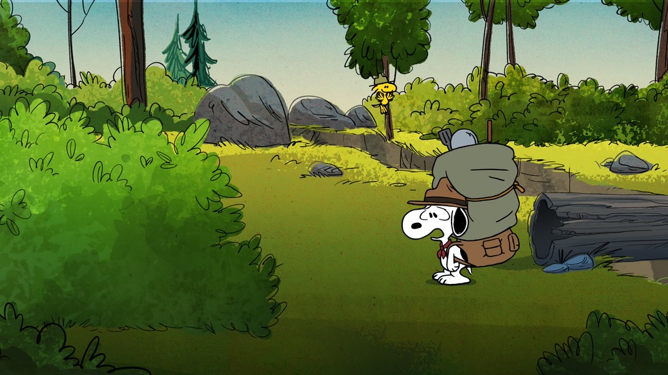
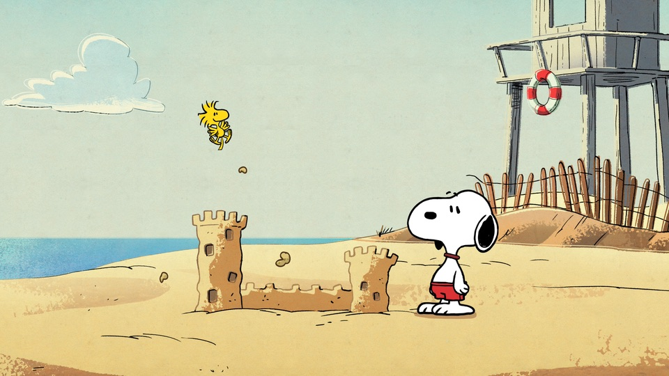
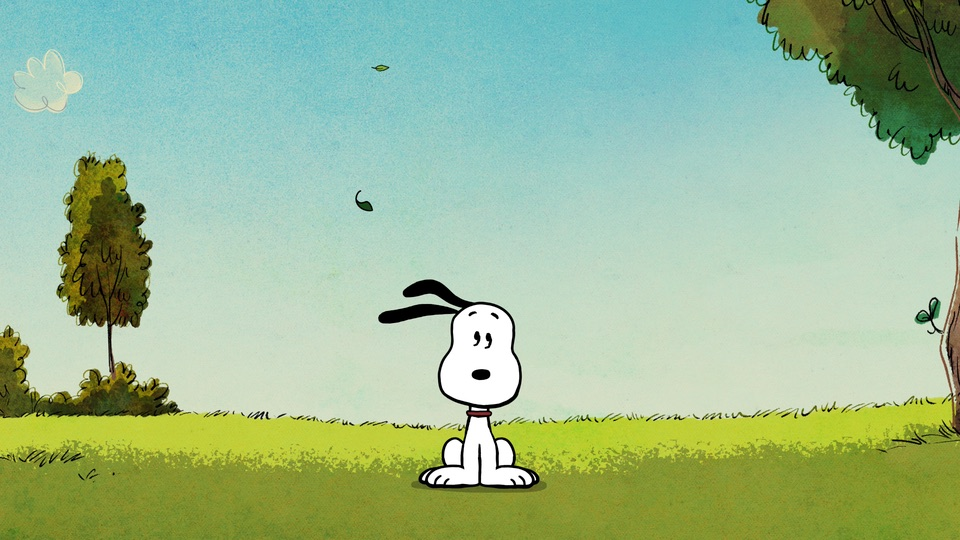
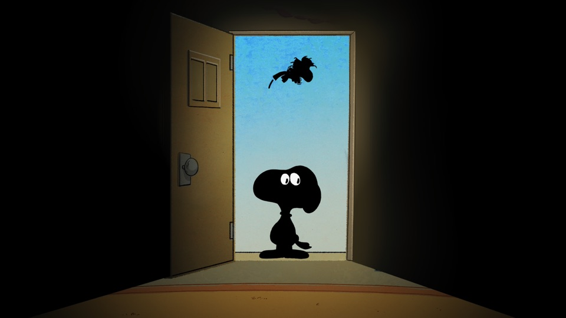
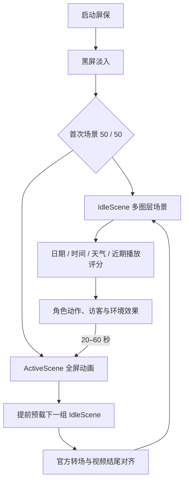

> [!WARNING]
> **当前签名状态与首次打开说明**
>
> Snoopy 目前使用 ad-hoc 签名，尚未使用 Apple Developer ID 签名或完成 Apple 公证。macOS 可能提示“无法验证开发者”或阻止打开。仅当文件来自你信任的来源时：先尝试打开一次，然后前往 **系统设置 → 隐私与安全性**，滚动到页面底部，在对应提示旁选择 **仍要打开** 并再次确认。
>
> 我们欢迎熟悉 macOS Developer ID、Hardened Runtime 和公证流程的贡献者通过 [Issue](../../issues) 讨论方案，或提交改进构建/签名流程的 Pull Request。请勿在 Issue、PR 或仓库中上传证书、私钥或其他签名凭据。

# Snoopy Saver

**简体中文** · [English](README_EN.md)

> [!IMPORTANT]
> **最新版本：Snoopy 1.1（V1.1.0）· 2026-07-21**
>
> 1.1 重点修复了长时间运行后的高功耗、风扇升速和 IdleScene 掉帧，并重构播放器、图层、HEIC 解码缓存与后台任务的生命周期，同时更新了系统设置中的封面缩略图。
>
> - [GitHub Release：分卷下载与完整更新说明](https://github.com/Cyber-Yichen/Snoopy-Saver/releases/tag/V1.1.0)——下载安装器 ZIP 和 4 个 DMG 分卷，全部放在同一目录后运行安装器。
> - [百度网盘：完整压缩包](https://pan.baidu.com/s/17pI0PTYSRbr7G-a06zrEBg?pwd=f2vm)——文件 `SnoopyScreenSaver 1.1zip.zip`，提取码 `f2vm`。

Snoopy Saver 的核心目标，是把 tvOS 中的史努比屏幕保护程序尽可能完整地移植到 macOS：保留全屏动画，也重建由背景、角色、访客、天气效果和调色板共同组成的多图层场景，并按照日期、时间、天气和近期播放记录选择下一段内容。

本项目当前已经完成：

- 从 tvOS 26.5 模拟器识别并适配完整的场景目录；
- 重建多图层 IdleScene、半色调背景和角色动作衔接；
- 复现五类官方转场，并让转场结束与全屏动画结尾对齐；
- 支持节日、史努比生日、时间段、天气和日常活动等特殊内容；
- 提供同时兼容 Apple Silicon 与 Intel Mac 的通用屏保构建。

## 你可以看到什么

基于本项目测试使用的 tvOS 26.5 素材集：

| 内容 | 数量 / 表现 |
| --- | --- |
| 全屏故事动画 | 65 个 ActiveScene |
| 多图层休闲场景 | 39 个 IdleScene |
| 环境调色板 | 84 套日期、时间与天气配色 |
| 官方转场 | 5 类：横向、时钟、圆形、思考气泡、睡梦气泡 |
| 特殊内容 | 节日、季节、史努比生日、日出日落、天气与月相等 |

屏保启动时有相同概率进入全屏动画或多图层场景。IdleScene 通常持续 20–60 秒，期间史努比会更换动作，Woodstock 和其他访客也可能出现，随后插播一段全屏动画。无声音、无时钟和文字叠加。

### 不同时间与季节

下面的画面由最终版场景目录按照对应日期、时间和天气条件实际评分后选出。相同条件下仍可能出现其他同分场景，近期播放记录也会影响最终选择。

<table>
  <tr>
    <td width="50%"><br><sub>春日清晨 · 晴朗</sub></td>
    <td width="50%"><br><sub>夏日下午 · 晴朗</sub></td>
  </tr>
  <tr>
    <td width="50%"><br><sub>秋日傍晚 · 有风</sub></td>
    <td width="50%"><br><sub>冬季深夜 · 下雪</sub></td>
  </tr>
</table>

### 8 月 10 日：史努比生日彩蛋

每年 8 月 10 日，日期相关性会优先触发史努比生日内容。冒烟测试确认清晨、下午、傍晚和深夜四个时段均能选中生日专属的全屏故事、多图层场景、访客与角色动作。



<sub>测试日期：2026-08-10，Asia/Shanghai；截图来自全屏生日场景。</sub>

> 本仓库只包含屏保实现源码、构建/安装脚本和设置缩略图，不包含素材获取代码、测试工具、实现分析记录、用于运行的 Apple 或 Peanuts 媒体，也不提交构建好的 `.saver`。README 中的少量低分辨率截图仅用于功能展示与测试记录。

## 工作方式



## 主要技术

- Swift 5、AppKit 与 `ScreenSaver.framework`
- AVFoundation：全屏视频、分段动作和预加载
- Core Animation：多图层合成、蒙版和转场
- Core Location + Open-Meteo：可选的天气、日出和日落匹配
- ImageIO：HEIC 序列解码与受限缓存
- Shell：通用架构构建和安装辅助

最低目标系统为 macOS 12。屏幕比例适配覆盖 16:9、16:10、3:2、21:9 和 4:3，不拉伸画面。

## 从源码构建

需要：

- macOS 与 Xcode
- 由使用者自行合法准备的本地素材

```bash
Scripts/build_saver.sh
```

本仓库不提供素材、下载器、解密工具或素材获取教程。完整构建要求使用者自行准备其有权访问的本地素材，并放入构建脚本期望的 `LocalAssets/` 目录。只验证代码编译、不打包媒体时可运行：

```bash
Scripts/build_saver.sh --code-only
```

所有本地媒体路径都被 `.gitignore` 排除。

安装本地构建：

```bash
Scripts/install_saver.sh
```

## 安全与稳定性

发布前测试包括：

- AddressSanitizer 播放与图层交接测试通过；
- 12 次连续强制场景切换无崩溃、黑屏或图层累积；
- HEIC 缓存限制为 192 MB，并在屏保停止时主动清空；
- 播放器、预加载、通知、KVO、时间观察器、定位和网络会话均显式清理；
- 运行时代码不执行外部命令，不包含第三方二进制或可执行资源；
- 天气请求仅通过 HTTPS 访问 Open-Meteo，并使用无 Cookie、无磁盘缓存、带超时和响应大小限制的临时会话。

测试中的常驻内存约为 295 MB，4K 双场景转场峰值约为 568 MB；停止后所有根图层均清空。不同素材、分辨率和 macOS 版本会产生不同结果。

## 参与贡献

欢迎通过 Issue 报告黑屏、画面比例、转场、素材选择和兼容性问题，也欢迎提交 Pull Request。涉及签名、公证或自动发布时，请只贡献流程、配置和文档，不要提交任何个人证书或密钥。

提交前请确认：

- 没有加入 `LocalAssets/`、MOV、HEIC、`.saver` 或其他 Apple/Peanuts 媒体；
- 能完成代码构建及相关 Smoke Test；
- 新增行为在 Apple Silicon 和 Intel 目标上都可编译。

## 免责声明

本项目是独立的非官方学习与技术交流项目，与 **Peanuts Worldwide、花生漫画、Apple Inc.** 及其关联公司均无隶属、授权、认可或合作关系。

Snoopy、Peanuts 及相关角色、名称和素材的权利归其各自权利人所有；Apple、tvOS、macOS 及相关商标和素材的权利归 Apple Inc. 所有。本仓库不提供、授权或授予任何第三方媒体素材的再分发权利。请仅在适用法律及你拥有合法访问权限的设备和模拟器环境中使用本项目。
