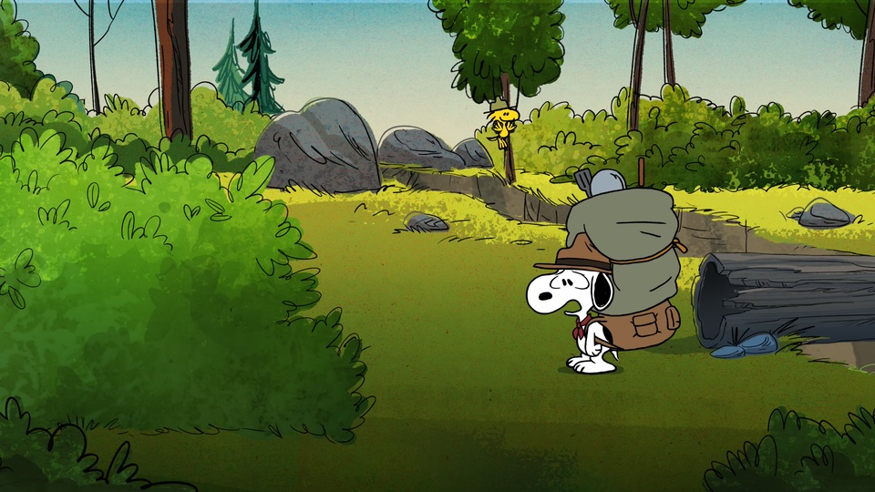
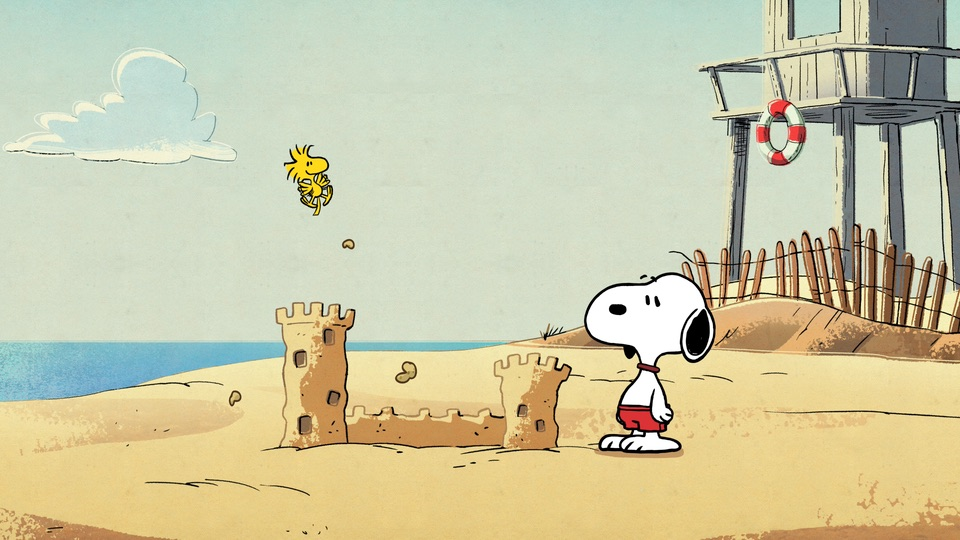
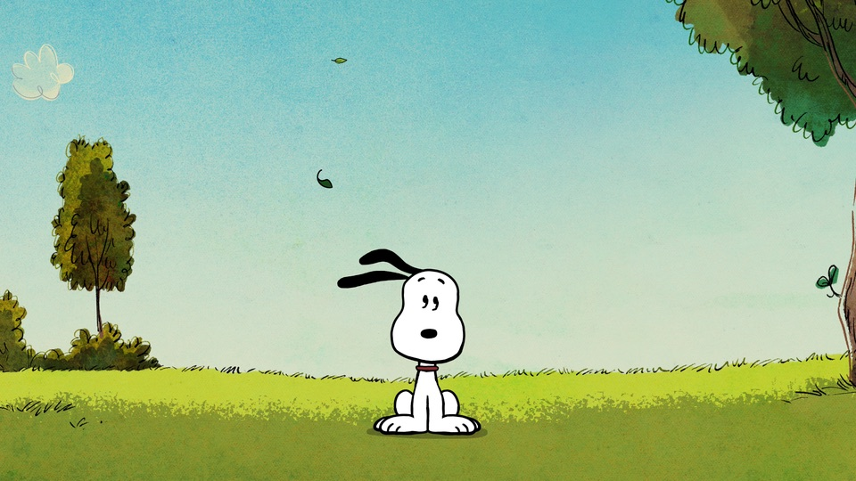
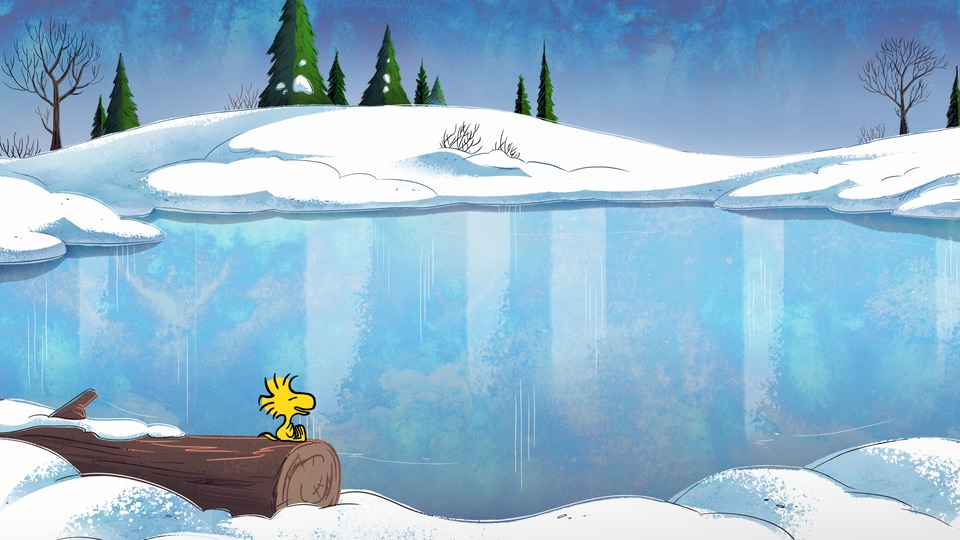
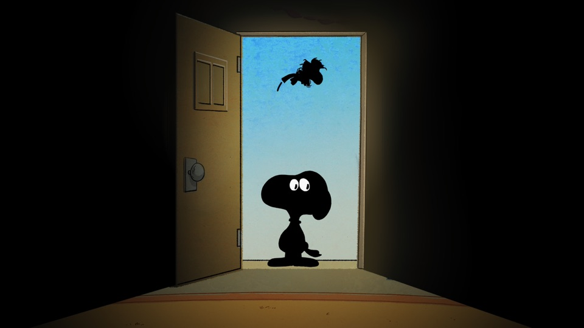
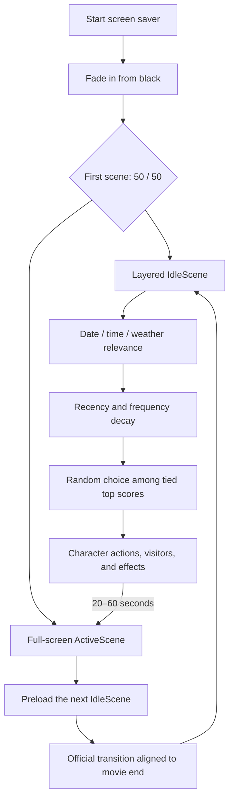

> [!WARNING]
> **Current signing status and first-launch instructions**
>
> Snoopy is currently ad-hoc signed. It is not yet signed with an Apple Developer ID or notarized by Apple. macOS may report that the developer cannot be verified or block the saver from opening. Only if you trust the source: try to open it once, then go to **System Settings → Privacy & Security**, scroll to the bottom, choose **Open Anyway** next to the relevant warning, and confirm again.
>
> Contributors familiar with macOS Developer ID, Hardened Runtime, and notarization are welcome to discuss a safe release workflow in an [Issue](../../issues) or submit a Pull Request improving the build/signing pipeline. Never upload certificates, private keys, or signing credentials to an Issue, PR, or repository.

# Snoopy Saver

[简体中文](README.md) · **English**

> [!IMPORTANT]
> **Latest release: Snoopy 1.1 (V1.1.0) · July 21, 2026**
>
> Version 1.1 focuses on long-running efficiency: it fixes elevated energy use, fan activity, and IdleScene frame drops; restructures the lifecycle of players, layers, HEIC decoding caches, and background work; and adds a new System Settings thumbnail.
>
> - [GitHub Release: split download and full release notes](https://github.com/Cyber-Yichen/Snoopy-Saver/releases/tag/V1.1.0)—download the installer ZIP and all four DMG parts, place them in one folder, then run the installer.
> - [Baidu Netdisk: complete archive](https://pan.baidu.com/s/17pI0PTYSRbr7G-a06zrEBg?pwd=f2vm)—file `SnoopyScreenSaver 1.1zip.zip`, extraction code `f2vm`.

Snoopy Saver aims to bring the Snoopy screen saver from tvOS to macOS as completely as possible. It preserves the full-screen animated stories while rebuilding the layered scenes made from backgrounds, characters, visitors, weather effects, and palettes. The next scene is selected using date, time, weather, and recent play history.

The project has achieved:

- a complete scene catalog reconstructed from the tvOS 26.5 Simulator;
- layered IdleScenes with the original halftone look and continuous character motion;
- 16 official transition categories, 13 conditional pairs, and all five visual families, aligned with the end of each full-screen movie;
- special scenes for holidays, Snoopy's birthday, time periods, weather, and routines;
- a universal screen-saver build for both Apple Silicon and Intel Macs.

## What you can see

Using the tvOS 26.5 asset set tested by this project:

| Content | Count / behavior |
| --- | --- |
| Full-screen stories | 65 ActiveScenes |
| Layered ambient scenes | 39 IdleScenes |
| Environment palettes | 84 date, time, and weather palettes |
| Official transitions | 16 scene categories and 13 conditional pairs across horizontal, clock, circular, thought-bubble, and sleeping-dream styles |
| Special content | Holidays, seasons, anniversaries, routines, weather, sunrise/sunset, moon phases, and more |

At launch, the saver has an equal chance of starting with a full-screen story or a layered scene. An IdleScene normally lasts 20–60 seconds, with changing Snoopy actions and occasional Woodstock or visitor appearances, before a full-screen story is inserted. There is no sound, clock, or text overlay.

Date themes cover the seasons, Christmas/Christmas Eve, Halloween, Thanksgiving, New Year, Valentine's Day, Lunar New Year, Earth Day, Aviation Day, Mother's Day, Father's Day, Independence Day, and Peanuts anniversaries including the moon landing, first Peanuts strip, Snoopy's debut, Snoopy's birthday, and Beethoven's birthday. Routine themes cover morning, school/work, brunch, lunch, afternoon, dinner, bedtime, and late night. Weather themes cover clear/sunny, fog, wind, rain, thunderstorms, ice, and snow.

### Times and seasons

The following scenes were selected by running the final catalog through its actual date, time, and weather scoring. Other tied scenes may appear under the same conditions, and recent play history can change the final selection.

<table>
  <tr>
    <td width="50%"><br><sub>Spring morning · Sunny</sub></td>
    <td width="50%"><br><sub>Summer afternoon · Clear</sub></td>
  </tr>
  <tr>
    <td width="50%"><br><sub>Autumn evening · Windy</sub></td>
    <td width="50%"><br><sub>Winter late night · Snowy</sub></td>
  </tr>
</table>

### August 10: Snoopy's birthday surprise

On August 10, date relevance prioritizes Snoopy birthday content. A smoke test confirmed that the dedicated full-screen story, layered scene, visitor, and character action can all be selected across morning, afternoon, evening, and late-night fixtures.



<sub>Test date: 2026-08-10, Asia/Shanghai; captured from the full-screen birthday scene.</sub>

> This repository contains the screen-saver implementation, build/install/validation scripts, and System Settings thumbnails only. It does not include asset-acquisition code, implementation notes, runtime Apple or Peanuts media, or a built `.saver` bundle. The few low-resolution screenshots in the README are included only as feature previews and test records.

## How it works



## Technology

- Swift 5, AppKit, and `ScreenSaver.framework`
- AVFoundation for full-screen movies, phased actions, and preloading
- Core Animation for layer composition, masks, and transitions
- Core Location + Open-Meteo for optional weather, sunrise, and sunset matching
- ImageIO for HEIC sequence decoding with a bounded cache
- Shell scripts for universal builds and installation helpers

The minimum deployment target is macOS 12. Layout tests cover 16:9, 16:10, 3:2, 21:9, and 4:3 displays without stretching the artwork.

## Build from source

Requirements:

- macOS and Xcode
- local assets that the user is legally authorized to access

```bash
Scripts/build_saver.sh
```

This repository does not provide Apple media, Apple-media acquisition downloaders, decryption tools, or acquisition instructions. A full build requires users to prepare assets they are legally authorized to access and place them under the `LocalAssets/` layout expected by the build script. To validate code compilation without packaging media, run:

```bash
Scripts/build_saver.sh --code-only
```

Every local media path is excluded by `.gitignore`.

### 1080p and CDN-lite variants

The variant tools only process local media that the user has already prepared legally; they do not retrieve content from Apple. The low-resolution pipeline keeps one preferred copy per Asset ID. FFmpeg converts ordinary videos to at most 1920×1080, HEVC Main 8-bit, low bitrate, with no audio. Ordinary libx265 cannot preserve Apple's auxiliary HEVC Alpha channel, so a macOS-native stage restores Apple's original 1080p character/visitor movies or uses AVFoundation's HEVC-with-Alpha encoder when only a 4K source exists. ImageIO then handles oversized HEIC Alpha frames:

```bash
python3 Scripts/build_lowres_assets.py LocalAssets .tmp/lowres-assets
Scripts/preserve_alpha_movies.sh LocalAssets .tmp/lowres-assets
Scripts/downscale_heic_assets.sh .tmp/lowres-assets
Scripts/validate_alpha_movies.sh .tmp/lowres-assets
python3 Scripts/validate_prepared_assets.py .tmp/lowres-assets --lowres
```

The ordinary MOV step requires FFmpeg. This project's release pipeline runs it in a Linux VM, so Homebrew is not required on macOS. Alpha MOV and HEIC processing use Xcode's Swift toolchain, AVFoundation, and ImageIO. All 258 transparent MOVs in the tested tvOS 26.5 catalog are checked for `ContainsAlphaChannel` and a maximum 1920×1080 frame.

The CDN-lite build keeps a small offline starter set and all metadata, then creates a size- and SHA-256-verified manifest for the omitted low-resolution movies:

```bash
python3 Scripts/build_cdn_lite_assets.py \
  .tmp/lowres-assets .tmp/cdn-lite \
  --cdn-base-url https://cdn.snoopy.bdmzw.top/media/1.1-r2 \
  --payload-output .tmp/cdn-payload
Scripts/build_variants.sh .tmp/lowres-assets .tmp/cdn-lite
```

Outputs are written to `.build/Variants/`: standard, 1080p, and CDN-lite savers, plus a separately distributable manifest and downloader.
The `.tmp/cdn-payload` tree can be published unchanged at `/www/wwwroot/snoopy.bdmzw.top/media/1.1-r2` on the origin.
After publication, the versioned remote manifest is available at `https://cdn.snoopy.bdmzw.top/media/1.1-r2/cdn-manifest.json`.

On every launch, the CDN-lite saver checks the same-origin HTTPS manifest in the background and stores missing or changed media at `~/Library/Application Support/Snoopy/Assets/Resolved`. A local file whose size, SHA-256, and recorded modification time still match is reused without another download. New files are installed atomically only after verification, and a short throttle coalesces simultaneous multi-display checks.

The same path- and SHA-256-restricted downloader is also available for manual use:

```bash
python3 Scripts/download_cdn_assets.py cdn-manifest.json \
  --base-url https://cdn.snoopy.bdmzw.top/media/1.1-r2
```

Install a local build with:

```bash
Scripts/install_saver.sh
```

## Security and stability

Pre-release validation includes:

- an AddressSanitizer build completing 12 rapid scene changes without an out-of-bounds or use-after-free finding;
- a release build completing 20 rapid forced changes without persistent root-layer growth and with clean shutdown;
- native validation of 258 HEVC Alpha movies at no more than 1920×1080, plus a pixel-alpha check on a sample actually returned by the CDN;
- a CDN updater smoke test proving one first-run download and zero redundant downloads on the second run;
- a 256 MB HEIC decode cache, phase-scoped official transition frames, and complete media-cache purging when the saver stops;
- explicit cleanup for players, prerolls, notifications, KVO, time observers, location, and network sessions;
- no external process execution, third-party binary, or executable resource at runtime;
- HTTPS-only Open-Meteo requests through an ephemeral, cookie-free, disk-cache-free session with timeouts and a response-size limit.

In the 1440×900 post-fix smoke run, the 1080p build peaked at 746 MB resident memory across six forced changes, while the CDN-lite build peaked at 764 MB across four changes. All root layers were removed after stopping. Results vary by media, resolution, display, and macOS version.

## Contributing

Issues are welcome for black screens, aspect ratios, transitions, scene selection, and compatibility. Pull Requests are welcome as well. For signing, notarization, or release automation, contribute workflows, configuration, and documentation only—never personal certificates or keys.

Before submitting, confirm that:

- no `LocalAssets/`, MOV, HEIC, `.saver`, or other Apple/Peanuts media is included;
- the code builds and relevant smoke tests pass;
- new behavior compiles for both Apple Silicon and Intel targets.

## Disclaimer

This is an independent, unofficial project for learning and technical discussion. It is not affiliated with, authorized by, endorsed by, or sponsored by **Peanuts Worldwide, Peanuts, Apple Inc.**, or any of their affiliates.

Snoopy, Peanuts, and related characters, names, and media belong to their respective rights holders. Apple, tvOS, macOS, and related trademarks and media belong to Apple Inc. This repository provides no license or redistribution rights for third-party media. Use the project only where permitted by applicable law and with assets you are legally authorized to access on your own devices and Simulator installations.
